# 🏛️ Arquitectura del Sistema — RataVix

> **Documento Oficial de Arquitectura v1.0**  
> *Aplicación Web de Almacenamiento Seguro con Arquitectura Dual, Cifrado en Cliente y Cero Conocimiento.*

---

## 🧭 1. Resumen Ejecutivo y Filosofía de Diseño

RataVix es una solución de almacenamiento personal en la nube construida sobre una premisa inquebrantable: **la privacidad y el control total de los datos pertenecen al usuario**. 

Para resolver el dilema clásico entre **usabilidad ágil** y **seguridad de grado militar**, RataVix implementa una **Arquitectura Dual**:

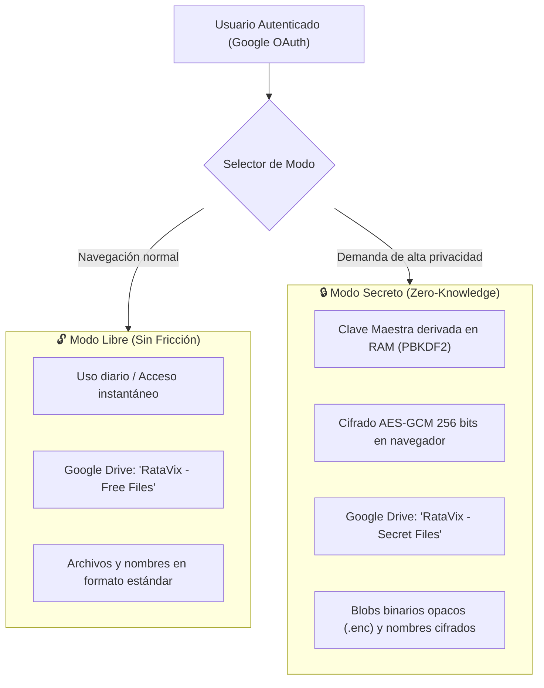

### 1.2 Topología de Infraestructura Cloud y Redes

Diagrama completo de la arquitectura distribuida en la nube ($0/mes), balanceo de carga, CDN y terminación SSL:

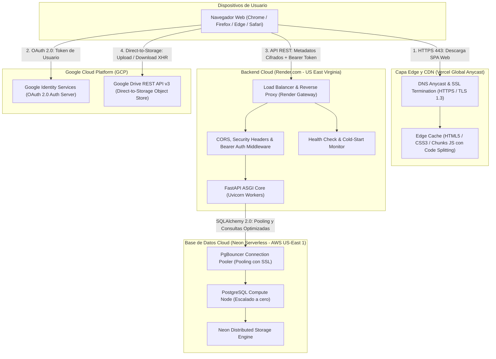

### 1.3 Diagrama de Casos de Uso del Sistema

Diagrama funcional de los actores y los casos de uso disponibles en la plataforma:

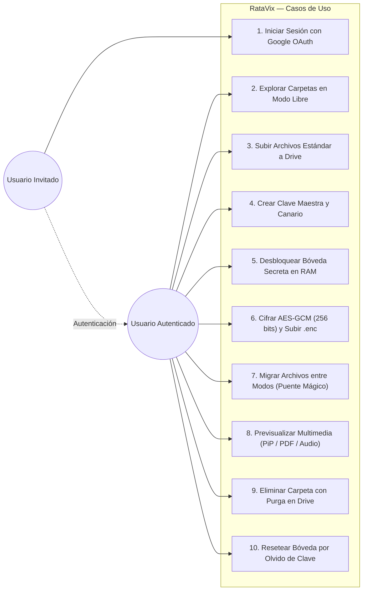

---

## 🛡️ 2. Arquitectura de Cero Conocimiento (Zero-Knowledge)

En el **Modo Secreto**, el sistema opera bajo un modelo estricto de **Conocimiento Cero**:

1. **Ni el Backend (FastAPI):** Nunca recibe contraseñas maestras, claves criptográficas, nombres originales ni contenido de archivos en texto plano.
2. **Ni Google Drive:** Solo almacena blobs binarios con extensión `.enc` e identificadores opacos. No puede inspeccionar el contenido ni aplicar minería de datos o indexación.
3. **Ni Terceros en Tránsito:** Toda la criptografía ocurre localmente en la memoria RAM del navegador antes de que cualquier paquete toque la red.

### 2.1 Especificación Criptográfica (Web Crypto API Nativa)

RataVix no utiliza librerías JavaScript externas para criptografía (como CryptoJS), eliminando vulnerabilidades de dependencias y maximizando el rendimiento mediante aceleración por hardware (**AES-NI**):

| Fase | Algoritmo | Parámetros | Propósito |
| :--- | :--- | :--- | :--- |
| **Derivación de Clave** | **PBKDF2** (Password-Based Key Derivation Function 2) | SHA-256, 100,000 iteraciones, Salt criptográfico de 16 bytes | Deriva una `CryptoKey` simétrica de 256 bits a partir de la contraseña maestra del usuario. |
| **Cifrado Simétrico** | **AES-GCM** (Galois/Counter Mode) | Longitud de clave: 256 bits, Tag de autenticación: 128 bits | Cifra y autentica metadatos (nombres de archivo/carpetas) y streams binarios. |
| **Vector de Inicialización** | **CSPRNG IV** | 12 bytes (96 bits) únicos por cada operación | Garantiza que dos archivos con el mismo contenido o nombre generen cifras completamente distintas. |
| **Empaquetado de Archivos** | **Prefijado de IV** | Primeros 12 bytes del archivo `.enc` = IV; Resto = Ciphertext + Tag | Autocontención: el archivo cifrado contiene su propio vector para descifrado sin sobrecargar la base de datos. |
| **Validación de Clave** | **Mensaje Canario** | Texto fijo `ratavix-master-key-canary-valid` cifrado con AES-GCM | Permite validar si la contraseña maestra ingresada es correcta sin almacenar ningún hash de la misma en el servidor. |

### 2.2 Protocolo de Autenticación OAuth 2.0 y Control de Sesión Única

Diagrama de secuencia que detalla el apretón de manos (*handshake*) criptográfico, la verificación de tokens de Google Identity Services y la invalidación atómica de sesiones concurrentes:

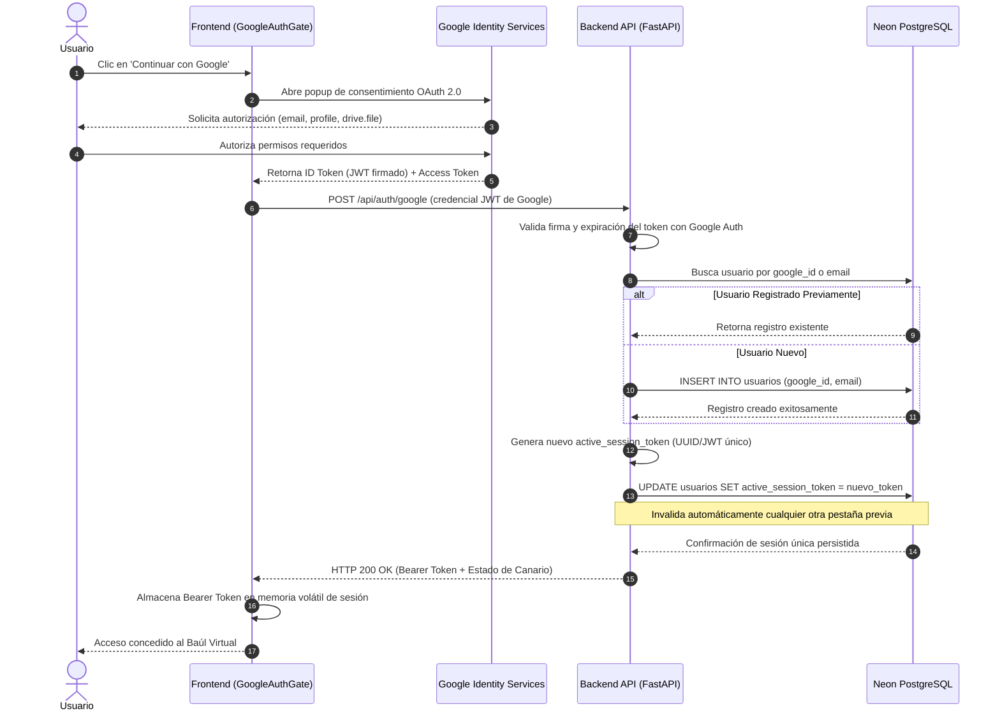

---

## ⚡ 3. Ciclo de Vida: Cifrado, Subida y Descarga

### 3.1 Flujo de Subida en Modo Secreto (Direct-to-Storage)

```mermaid
sequenceDiagram
    autonumber
    actor U as Usuario
    participant FE as Frontend (React + Web Crypto)
    participant RAM as Memoria RAM (CryptoContext)
    participant GD as Google Drive API
    participant BE as Backend API (FastAPI)
    participant DB as Base de Datos (Neon PostgreSQL)

    U->>FE: Selecciona archivo local (ej: documento.pdf)
    FE->>FE: Valida límite preventivo de RAM (500 MB)
    FE->>RAM: Solicita CryptoKey simétrica en memoria
    RAM-->>FE: Retorna CryptoKey activa
    
    rect rgb(30, 40, 60)
        Note over FE: Pipeline Criptográfico en Cliente
        FE->>FE: Genera IV aleatorio (12 bytes)
        FE->>FE: Cifra contenido con AES-GCM 256 bits
        FE->>FE: Concatena IV + Ciphertext en Blob .enc
        FE->>FE: Cifra nombre "documento.pdf" con AES-GCM + IV propio
    end

    FE->>GD: Upload Multipart XHR (Blob .enc hacia 'RataVix - Secret Files')
    Note over FE,GD: Telemetría en vivo: bytes transferidos, %, MB/s y ETA
    GD-->>FE: Retorna drive_file_id (ej: 1a2B3c...)

    FE->>BE: POST /api/tesoros (drive_file_id, nombre_cifrado, iv, es_cifrado=True)
    BE->>DB: INSERT INTO tesoros (...)
    DB-->>BE: Registro persistido
    BE-->>FE: HTTP 201 Created
    FE-->>U: Archivo disponible en el Baúl Secreto
```

### 3.2 Flujo de Descarga y Previsualización en Vivo

1. **Consulta de Metadatos:** El cliente solicita a FastAPI la lista de carpetas y archivos. FastAPI devuelve exclusivamente identificadores, nombres cifrados e IVs en Base64.
2. **Descifrado en RAM:** `CryptoContext` toma la `CryptoKey` viva en memoria y descifra instantáneamente los nombres para mostrarlos en la cuadrícula de mosaicos.
3. **Descarga Directa del Blob:** Al pulsar `👁️ Ver` o `⬇️ Descargar`, el navegador descarga directamente el stream de bytes desde Google Drive mediante `XMLHttpRequest` con telemetría visual.
4. **Desempaquetado y Decodificación:**
   - El cliente extrae los primeros 12 bytes del stream recibido (IV de archivo).
   - El resto del buffer se introduce en `window.crypto.subtle.decrypt()`.
   - Se genera una URL de objeto en memoria (`URL.createObjectURL(plainBlob)`) con su respectivo tipo MIME estricto.
5. **Liberación de Memoria:** Al cerrar el modal de visualización, se invoca inmediatamente `URL.revokeObjectURL()` para evitar fugas de memoria RAM.

### 3.3 Máquina de Estados de la Bóveda y Custodia de Memoria RAM

Diagrama de flujo y máquina de estados que modela el ciclo de vida de la aplicación, la protección de la clave efímera en memoria volátil y el protocolo de auto-bloqueo:

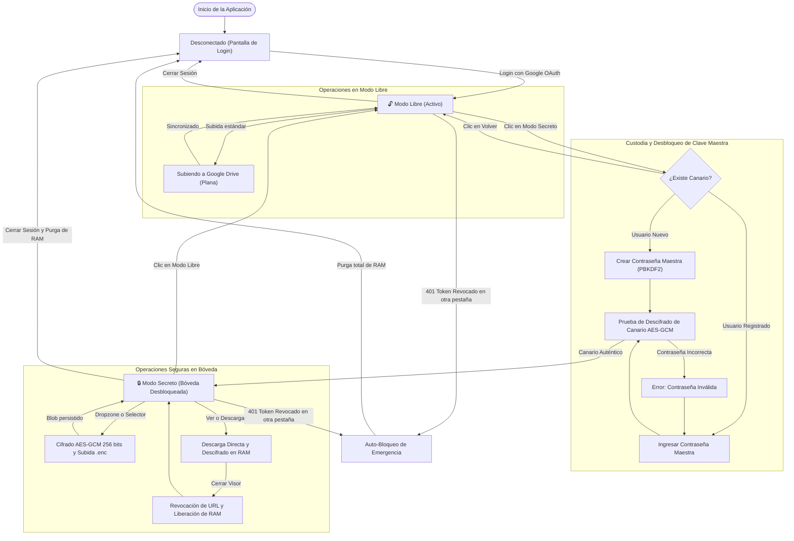

---

## 🗄️ 4. Modelo de Datos Virtual y Separación de Responsabilidades

RataVix implementa un sistema de archivos virtual jerárquico superpuesto a Google Drive. Google Drive actúa como un almacén de objetos planos (*Object Storage*), mientras que Neon PostgreSQL gestiona la estructura jerárquica de carpetas y permisos:

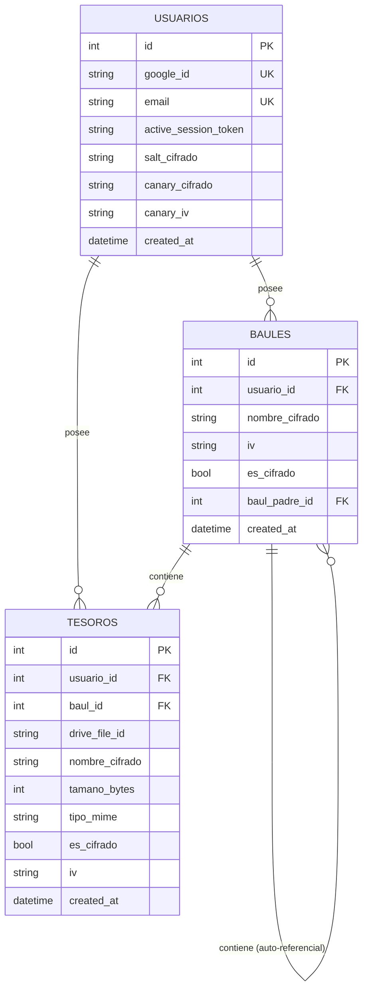

### 4.1 Purga en Cascada y Eliminación Inteligente
Cuando un usuario elimina una carpeta (`baul`):
1. **Recolección en 1 Consulta (Backend):** FastAPI ejecuta un mapeo en memoria de toda la descendencia jerárquica y recopila todos los `drive_file_id` asociados en microsegundos (evitando el antipatrón de consultas N+1).
2. **Purga en Base de Datos:** Los registros en PostgreSQL se eliminan en cascada atómica (`ondelete="CASCADE"`).
3. **Purga Concurrente en Google Drive (Frontend):** El backend devuelve la lista `deleted_drive_file_ids` al frontend, el cual dispara solicitudes asíncronas concurrentes a la API de Google Drive para eliminar los archivos remotos, erradicando por completo archivos huérfanos.

### 4.2 Arquitectura en Capas del Backend (Clean / Layered Architecture en FastAPI)

Diagrama de la arquitectura por capas que aísla el transporte HTTP, la seguridad perimetral, la lógica de negocio y la persistencia relacional:

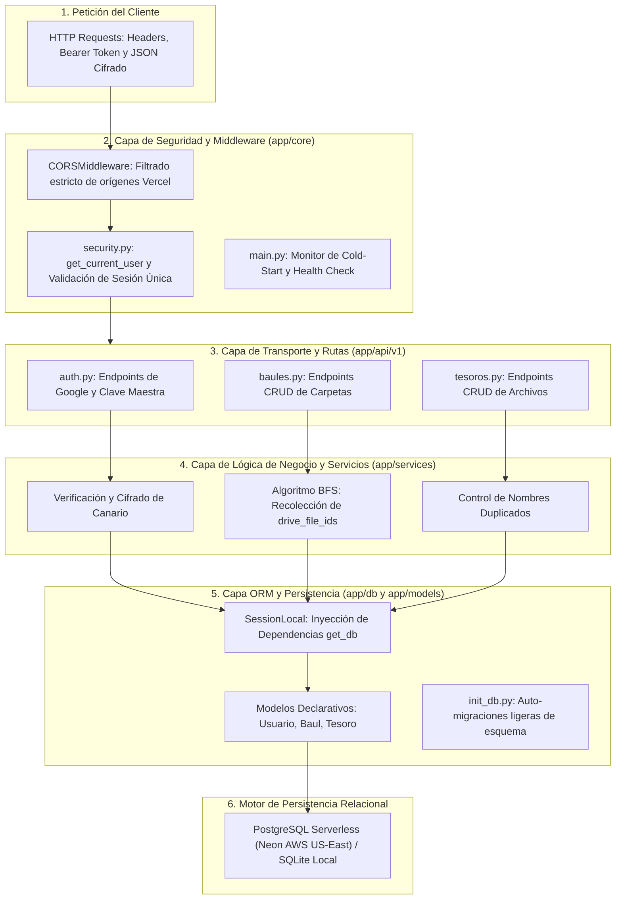

---

## 🧱 5. Aplicación de Principios SOLID

Durante la refactorización arquitectónica de la Fase 5, el código se estructuró bajo los principios SOLID para garantizar mantenibilidad a largo plazo:

### S — Responsabilidad Única (Single Responsibility Principle)
* **Frontend:**
  * `VaultExplorer.jsx`: Coordina exclusivamente la navegación y estado del explorador.
  * `ExplorerGrid.jsx`: Responsable únicamente de la representación visual de mosaicos y Drag & Drop.
  * `FolderActionModals.jsx`: Encargado de los formularios modales de creación, renombrado y movimiento.
  * `useVaultMigration.js`: Custom Hook que encapsula al 100% la lógica del Puente Mágico entre modos (descarga, recifrado y actualización).
  * **Estilos CSS:** Desacoplados de un archivo monolítico a 8 submódulos CSS por componente.
* **Backend:**
  * `security.py`: Control de sesiones únicas y autenticación HTTP Bearer.
  * `crud/`: Operaciones puras de base de datos sin lógica de presentación.
  * `api/v1/`: Rutas HTTP que delegan la lógica a los servicios correspondientes.

### O — Abierto / Cerrado (Open/Closed Principle)
* El catálogo de detección de tipos de archivo (`fileTypes.js`) permite añadir nuevos formatos, extensiones y categorizaciones visuales sin necesidad de modificar el código interno del visor ni de la cuadrícula.
* Los componentes visuales soportan temas (`Moderno` vs. `Pixel Art`) mediante inyección de clases y estilos desacoplados sin alterar la lógica de negocio.

### L — Sustitución de Liskov (Liskov Substitution Principle)
* La capa de persistencia soporta indistintamente SQLite (para tests unitarios y desarrollo local aislado) y PostgreSQL (para producción en Neon) mediante SQLAlchemy 2.0 y su abstracción agnóstica de dialectos.

### I — Segregación de Interfaces (Interface Segregation Principle)
* El contrato de API (`docs/API_CONTRACT.md`) define esquemas de entrada y salida concisos con Pydantic (`BaulCreate`, `BaulUpdate`, `BaulResponse`). Ningún endpoint obliga al cliente a recibir o enviar campos innecesarios.

### D — Inversión de Dependencias (Dependency Inversion Principle)
* FastAPI utiliza inyección de dependencias (`Depends(get_db)`, `Depends(get_current_user)`), permitiendo mockear la base de datos o el usuario autenticado en la suite de pruebas sin acoplamiento a servicios externos.

### 5.1 Diagrama de Clases y Arquitectura de Componentes

Diagrama de clases UML que representa las relaciones entre los servicios cliente (criptografía y Google Drive) y los modelos de persistencia del backend:

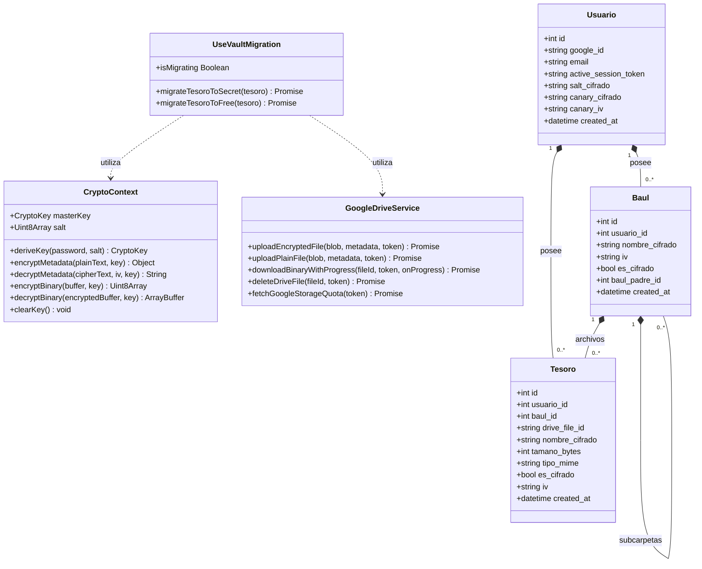

### 5.2 Árbol de Componentes de Frontend y Flujo de Estado (React 18)

En el frontend moderno con React, la arquitectura no se modela con clases, sino a través de la **jerarquía de componentes funcionales**, los **contextos globales** y los **custom hooks**:

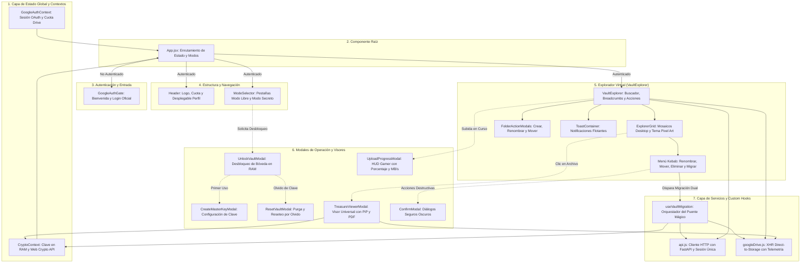

### 5.3 Diagrama de Flujo de Datos Unidireccional y Custom Hooks (React Dataflow Lifecycle)

Diagrama dinámico que ilustra cómo fluye la información en el cliente ante un evento de usuario (ejemplo: migración atómica por arrastre o menú contextual):

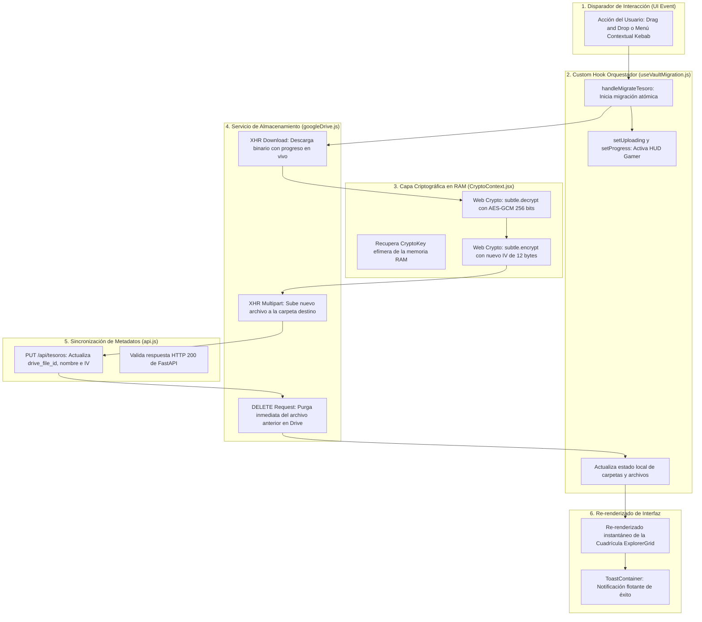

---

## 🔐 6. Modelo de Amenazas y Control de Sesión Única

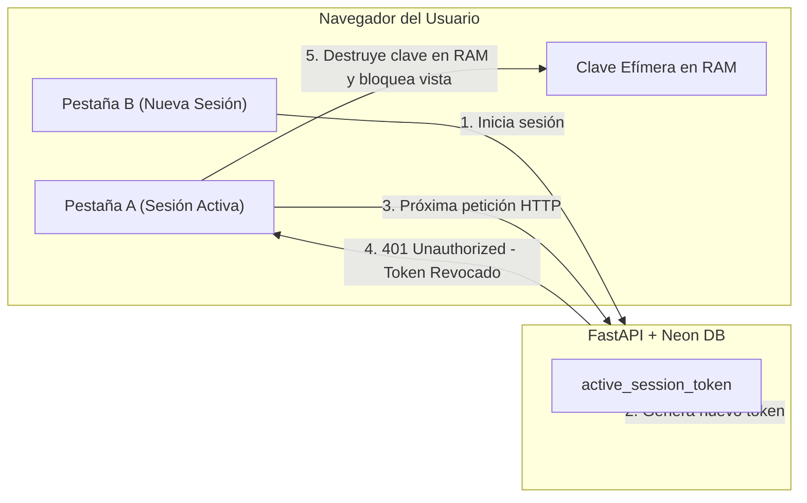

1. **Destrucción Inmediata de Claves:**
   * La clave maestra nunca toca `localStorage`, `sessionStorage`, `IndexedDB` ni cookies.
   * Al pulsar `🚪 Cerrar Sesión`, cambiar de cuenta o recargar la página (F5), la referencia de `CryptoKey` en JavaScript se desasigna y el recolector de basura de Chromium la destruye de la RAM.
2. **Control de Sesión Única:**
   * Si el usuario inicia sesión en otro dispositivo o pestaña, el backend actualiza su `active_session_token`.
   * Cualquier petición subsecuente desde la sesión anterior recibe un código `401 Unauthorized`, provocando el autobloqueo de la interfaz y la purga de la clave en memoria.
3. **Defensa contra Fugas de Memoria (RAM Exhaustion):**
   * El cliente intercepta cualquier archivo que supere los **500 MB** antes de intentar cargarlo en memoria con `file.arrayBuffer()`, protegiendo la pestaña de caídas por falta de memoria (*Out of Memory*).

